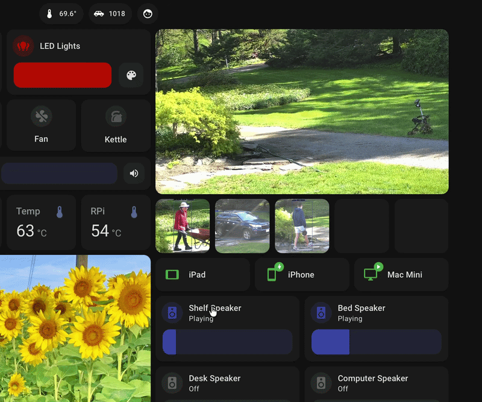
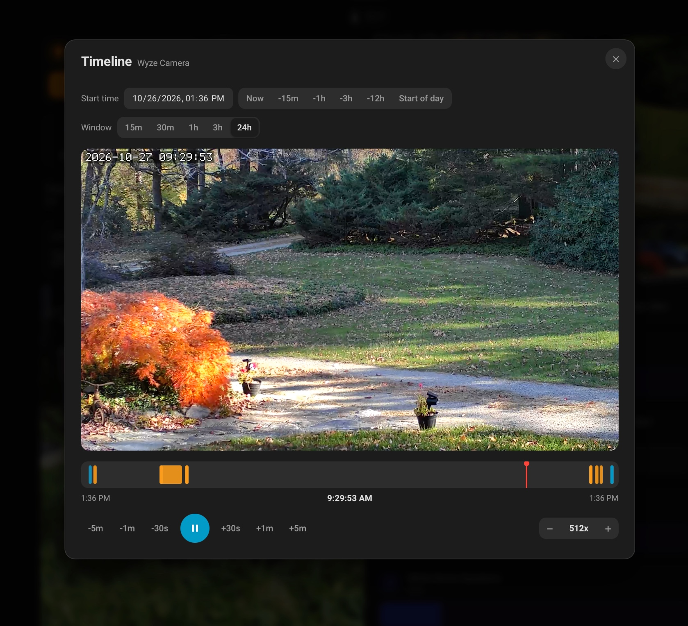
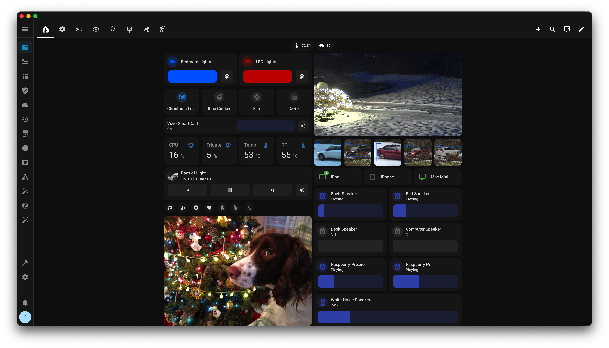
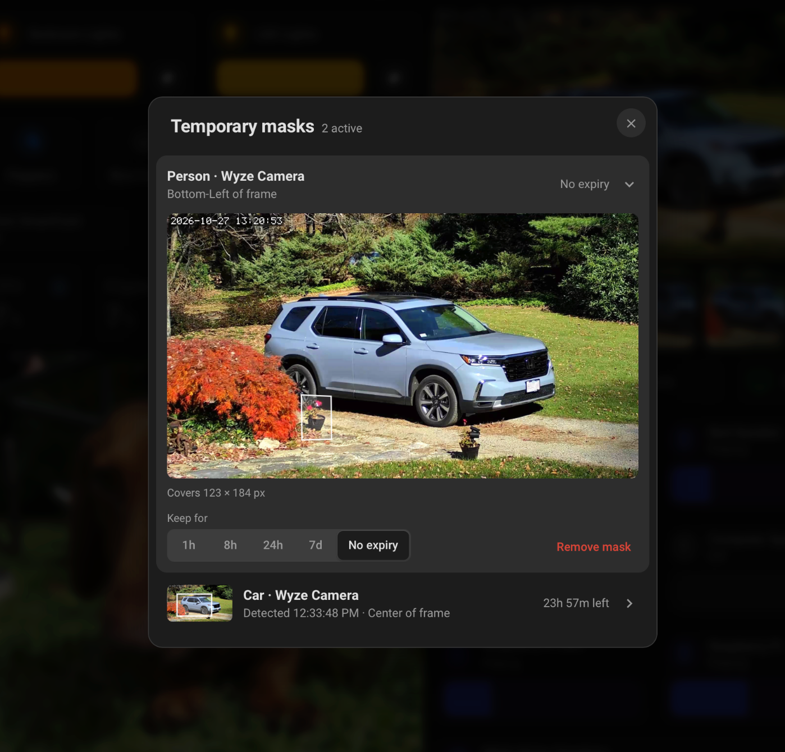
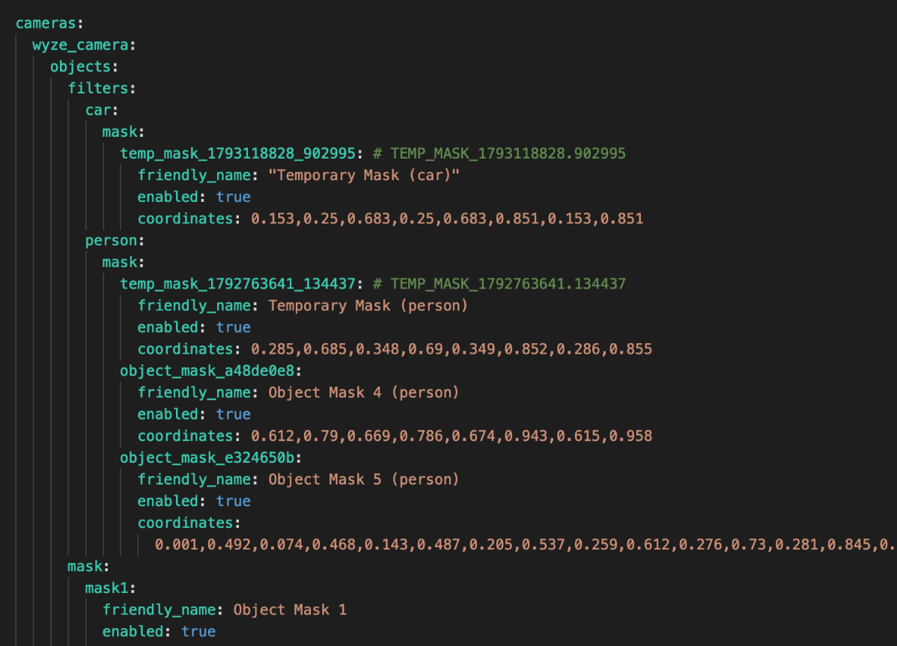

# Frigate Events Card

An all-in-one Lovelace card for Frigate: recent detection gallery, WebRTC live view, continuous timeline playback, and temporary false-positive masking.

**Available directly in HACS** — search for **Frigate Events Card** under Frontend.







<details>
<summary><strong>Contents</strong></summary>

- [What's New](#whats-new-in-v26)
- [Features](#features)
- [Installation](#installation)
- [Usage](#usage)
  - [Examples](#examples)
  - [Timeline & Continuous Playback](#timeline--continuous-playback)
  - [Context Menu & Event Management](#context-menu--event-management)
  - [Temporary Masking (Optional)](#temporary-masking-optional)
- [Configuration Options](#configuration-options)
- [Requirements](#requirements)
- [Troubleshooting](#troubleshooting)
- [Contributing](#contributing)
- [Support & Feedback](#support--feedback)

</details>

## What's New in v2.6

- **Temporary Mask Manager overhaul**: Live camera snapshots with mask polygon overlays, accurate countdowns, per-mask duration changes, instant removal, and reliable cleanup of expired or orphaned masks — including after Frigate reconnects from an outage.
- **Active Masks sensor**: New `sensor.frigate_active_masks` diagnostic entity exposing the active mask count, mask details, pending-restart state, and detected Frigate version for dashboards and automations.
- **Frigate 0.18+ mask compatibility**: Robust support for dictionary-format object masks, automatic adoption of masks found in Frigate's config, and safer mask retention across restarts.
- **Timeline & continuous playback**: Integrated VOD timeline with an interactive scrubber, color-coded event markers, quick jumps, variable playback speeds, click-to-timeline navigation, and mute controls.
- **Security hardening**: Event deletion now goes through the admin-only `frigate_temp_mask.delete_event` service, proxy views require authentication, hard-coded Frigate URL/camera fallbacks were removed, and event/mask details render via `textContent` to prevent HTML injection.
- **Signed snapshot fix**: `auth/sign_path` requests now use the correct `expires` parameter, so signed thumbnails and camera previews load reliably behind authenticated reverse proxies.

## Features

- **Fast & Lightweight**: Minified and optimized for quick loading.
- **Live Updates**: Instantly shows new events via WebSocket.
- **Responsive**: Auto-adjusting grid layout that works great on mobile.
- **Sections View Ready**: Fully compatible with Home Assistant's Sections view, rendering full-width and scaling properly.
- **Rich Media**: High-quality snapshots with optional zooming.
- **Bounding Boxes**: Toggle the visibility of Frigate's detection bounding box overlays on event snapshots.
- **Video Playback**: Natively stream MP4 and HLS (`.m3u8`) event clips directly in your browser.
- **Hover Previews**: Instantly play video clips when hovering over any event, with smooth auto-tracking that pans and follows the detected object throughout the clip.
- **Live Camera Feed**: Optional WebRTC live feed above the event gallery — click to open fullscreen, true continuous peer connection, zero-flash re-renders, Smart TV browser optimizations, and 24/7 self-healing auto-reconnect for network drops and Frigate restarts.
- **Scrollable Gallery**: Optional horizontal scroll mode with arrow navigation and hidden scrollbar for a clean, native feel.
- **Customizable Layout**: Reverse the rendering order or offset events to build the exact dashboard you want.
- **Daily Reset**: Optional automated clearing for a fresh daily view.
- **Timeline & Continuous Playback**: Browse continuous Frigate VOD recordings in a dedicated player with an interactive scrubber, color-coded event markers, quick jumps, and variable playback speeds up to 4096x. [Learn more](#timeline--continuous-playback).
- **Interactive Details Modal**: Deep-dive popup displaying full event information, including AI-generated descriptions (if available), duration, date, camera, zones, and accuracy. Supports interactive previous/next navigation arrows and keyboard hotkeys (ArrowLeft / ArrowRight / Escape).
- **Right-Click & Long-Press Context Menu**: Right-click (desktop) or long-press (mobile) any event thumbnail to instantly view details, view the exact moment in continuous timeline, permanently delete events from Frigate, or apply temporary false-positive masks.
- **Configurable Modal Metadata**: Fine-grained visibility controls to show/hide specific metadata elements (like date, duration, or camera name) in the details popup.

## Installation

### HACS (Recommended)

This card is available directly in [HACS](https://hacs.xyz/) (Home Assistant Community Store) — no custom repository required.

[](https://my.home-assistant.io/redirect/hacs_repository/?owner=saihgupr&repository=frigate-events-card&category=plugin)

1. Open **HACS** in Home Assistant.
2. Search for **Frigate Events Card**.
3. Click on it and select **Download**.
4. When prompted, reload your browser cache.

### Manual Installation

1. Download `frigate-events-card.js` from the [latest release](https://github.com/saihgupr/frigate-events-card/releases)
2. Copy it to your Home Assistant `www/` folder
3. Add the resource in your Lovelace dashboard:
   ```yaml
   resources:
     - url: /local/frigate-events-card.js
       type: module
   ```
4. Add the card to your dashboard

## Usage

A minimal card configuration:

```yaml
type: custom:frigate-events-card
frigate_client_id: frigate
event_count: 5
```

<details>
<summary><strong>Full Configuration Example</strong> (Click to expand)</summary>

```yaml
type: custom:frigate-events-card
frigate_client_id: frigate
event_count: 5

# Optional: Live camera feed above events (WebRTC — no polling, no flash)
live_view: true
live_view_entity: camera.wyze_camera

# Optional filters
cameras:
  - wyze_camera
labels:
  - person
  - car
zones:
  - front_a
  - front_b

# Optional: Video playback settings
video: true
video_on_hover: true

# Optional: Video timing offsets (seconds or per-label/zone map)
video_start_skip_seconds: 1
video_end_skip_seconds: 2

# Optional: Tracking synchronization (milliseconds or per-label/zone map)
tracking_pan_delay:
  car: -1500
  person: -3000
  person:front_door: 500
  default: 0

# Optional: Tracking smoothness (0.0 to 1.0)
tracking_smoothing: 0.5

# Optional: Scrollable gallery settings
scroll: true
scroll_limit: 40
show_scroll_arrows: true

# Optional: Bounding box overlay (snapshots)
show_bounding_box: true

# Optional: Detail modal metadata visibility toggles
show_description: true
show_date: true
show_accuracy: true
show_duration: true
show_camera_name: true
show_zones: true
show_modal_navigation: false

# Optional: Layout overrides
reverse: true
offset: 1

# Optional: Timeline (Frigate 0.13 VOD)
show_timeline: true
timeline_on_click: true
timeline_default_window_hours: 1
timeline_event_seek_offset: 0

# Optional: Reset display daily at a specific time (24hr format)
daily_clear_time: "04:00"

# Optional: Debugging
debug: true
```

</details>

### Examples

#### Scrollable Gallery

This example creates a horizontally scrollable gallery showing 6 thumbnails at a time, loading up to 40 total events.

```yaml
type: custom:frigate-events-card
frigate_client_id: frigate
event_count: 6
scroll: true
scroll_limit: 40
video_on_hover: true
```

#### Live Camera Feed

This example adds a live WebRTC camera feed above the event gallery. The card supports two WebRTC streaming modes:

1. **Home Assistant WebRTC API (Default)**: Negotiates WebRTC through Home Assistant's native camera WebSocket protocol (`camera/web_rtc_offer`). Ideal for remote viewing (e.g. Home Assistant Cloud / Nabu Casa) as signaling passes through HA.
2. **Direct go2rtc WebRTC (`go2rtc_url`)**: Negotiates WebRTC directly with your Frigate `go2rtc` server via `go2rtc_url` (e.g. `http://192.168.1.211:1984`). Bypasses Home Assistant custom component dependencies, reducing HA CPU overhead and delivering sub-second startup times — ideal for local TV dashboards and wall tablets.

> **Requirements:** Dashboard must be served over **HTTPS** (or `localhost`).

##### Mode 1: Home Assistant Native WebRTC
```yaml
type: custom:frigate-events-card
frigate_client_id: frigate
event_count: 5
live_view: true
live_view_entity: camera.wyze_camera
video_on_hover: true
```

##### Mode 2: Direct go2rtc WebRTC (Recommended for Local TVs / Wall Tablets)
```yaml
type: custom:frigate-events-card
frigate_client_id: frigate
event_count: 5
live_view: true
live_view_entity: camera.wyze_camera
go2rtc_url: http://192.168.1.211:1984
video_on_hover: true
```

Optionally override the video aspect ratio (defaults to `16 / 9`):

```yaml
live_view_aspect_ratio: "4 / 3"
```

<details>
<summary><strong>Example: Advanced Video & Tracking Configuration</strong> (Click to expand)</summary>

This example shows a real-world configuration for fine-tuning video clip endpoints and tracking synchronization based on detection labels.

```yaml
type: custom:frigate-events-card
video_start_skip_seconds:
  person: 0
  car: 1
video_end_skip_seconds:
  car: 33
  person: 32
  default: 0
tracking_pan_delay:
  car: -500
  person: -3000
  default: 0
tracking_smoothing: 1
labels:
  - person
  - car
  - umbrella
show_bounding_box: false
video: true
video_on_hover: true
daily_clear_time: '04:00'
debug: false
live_view: true
live_view_entity: camera.wyze_camera
go2rtc_url: http://192.168.1.211:1984
```
</details>

### Timeline & Continuous Playback

The Timeline modal plays continuous recordings from Frigate 0.13+ VOD, so you can review footage around an event instead of being limited to the event clip itself. Click any event thumbnail (with `timeline_on_click: true`) or use the live feed's right-click menu to open it.

<p align="center">
  
</p>

- **Interactive scrubber**: Drag anywhere on the track to seek. The current time is shown above the playhead, with the window start and end times on either side.
- **Event markers**: Color-coded markers highlight detections across the selected window, making it easy to jump between moments.
- **Quick jumps**: Choose `Now`, `-15m`, `-1h`, `-3h`, `-12h`, or `Start of Day` to reposition the timeline instantly.
- **Window size**: Switch between `15m`, `30m`, `1h`, `2h`, and `3h` recording windows.
- **Fine controls**: Nudge playback with `-5m`, `-1m`, `-30s`, `+30s`, `+1m`, and `+5m` buttons.
- **Variable speed**: Use the `-`/`+` controls to step from `0.5x` up to `4096x` (speeds above `16x` use frame stepping), with gapless auto-advance across recording chunks.

> **Note:** Timeline playback requires the Frigate integration and access to Frigate's VOD recordings. Streams are signed automatically, so HLS playback works on iOS Safari, the Home Assistant Companion App, and authenticated reverse proxies.

See [Advanced Layout & Timeline Settings](#advanced-layout--timeline-settings) for all timeline options.

### Context Menu & Event Management

Right-clicking (desktop) or long-pressing (touch devices) any event thumbnail opens a context menu with these actions:

* **View Details**: Opens the interactive details modal with snapshot, video, AI description, detection score, and timestamp metrics.
* **View in Timeline**: Opens continuous playback at the event's start time. See [Timeline & Continuous Playback](#timeline--continuous-playback).
* **Delete Event**: Permanently deletes the event, snapshot, and clip from Frigate and removes the thumbnail immediately.
* **Temporary Masking (Optional)**: Add or remove a false-positive mask when the [companion integration](#temporary-masking-optional) is installed.

Right-clicking the live feed exposes the same context menu, with direct shortcuts for **Timeline** and **Mask Manager**.

### Temporary Masking (Optional)

The card works standalone. The `frigate_temp_mask` companion integration enables temporary masks for recurring false detections such as a parked car, package, or wheelbarrow. Masks use a 10% expanded bounding box around the detection, are written to Frigate's config, and can be changed or removed later.

<p align="center">
  
  
</p>

* **Flexible durations**: Set a mask for 1h, 4h, 8h, 12h, 24h, 48h, 7d, or custom hours.
* **Live previews**: The Mask Manager captures a fresh camera snapshot and overlays each active mask polygon.
* **Instant removal**: Remove a mask from the context menu without waiting for a detector restart on Frigate 0.18+.

#### Setup

1. Copy the `custom_components/frigate_temp_mask` integration into your Home Assistant `/config/custom_components/` directory (or use `deploy.sh`).
2. Add `frigate_temp_mask:` to your `/config/configuration.yaml`.
3. Restart Home Assistant (or reload YAML).

The card automatically detects the integration and adds **Temporary Mask**, **Change Duration**, and **Remove Mask** to the context menu.

> [!NOTE]
> **Restart Behavior by Frigate Version**:
> * **Adding or Updating Masks:** Frigate **automatically restarts** its internal detector process (~1–2 seconds) so false alarms stop immediately.
> * **Removing Masks on Frigate 0.18+:** The mask is **instantly disabled** via the Frigate API (`PUT /api/camera/{camera}/set/object_mask/{name}`) and cleaned from `config.yml` — **no detector restart required**.
> * **Removing Masks on Frigate 0.13 and earlier:** The mask is cleaned from `config.yml` without restarting Frigate. The **Pending Restart Tracker** in the Mask Manager provides a 1-click **Restart Frigate** button.

<details>
<summary><strong>Integration Services Reference</strong> (Click to expand)</summary>

The `frigate_temp_mask` integration exposes the following services under Home Assistant **Developer Tools > Actions / Services**:

| Service | Description | Key Parameters |
|---|---|---|
| `frigate_temp_mask.add_mask` | Adds a temporary bounding-box mask around a false detection in Frigate. | `event_id` (required), `duration_hours` (default: 24), `camera` (optional, auto-inferred from event), `padding` (default: 0.10), `mask_id` (optional) |
| `frigate_temp_mask.set_duration` | Updates the expiration duration for an active temporary mask without restarting Frigate. | `mask_id` (required), `duration_hours` (required) |
| `frigate_temp_mask.remove_mask` | Removes a temporary mask from Frigate config on disk without interrupting recordings. | `mask_id` (required) |
| `frigate_temp_mask.prune_all` | Removes all temporary masks from Frigate configuration. | *None* |
| `frigate_temp_mask.restart` | Restarts the Frigate detector backend process to apply pending configuration changes. | *None* |
| `frigate_temp_mask.sync` | Forces a manual state synchronization with running Frigate process uptime and active config. | *None* |
| `frigate_temp_mask.delete_event` | Deletes an event, snapshot, and recording from Frigate. | `event_id` (required) |

</details>

<details>
<summary><strong>Mobile Notification Blueprint (iOS & Android)</strong> (Click to expand)</summary>

Attach **Temporary Mask** action buttons directly to Frigate mobile notifications. Tapping an action calculates the expanded polygon mask, injects it into Frigate, and restarts the detector without opening the dashboard.

<p align="center">
  
</p>

[](https://my.home-assistant.io/redirect/blueprint_import/?blueprint_url=https%3A%2F%2Fgithub.com%2Fsaihgupr%2Ffrigate-events-card%2Fblob%2Fmain%2Fblueprints%2Fautomation%2Ffrigate_temp_mask_notification.yaml)

> [!TIP]
> **Ways to Import the Blueprint:**
>
> * **Option A (1-Click Badge above):** Click the **Open Home Assistant** badge above.
> * **Option B (Import by URL):** In Home Assistant, go to **Settings > Automations & Scenes > Blueprints > Import Blueprint** and paste:
>   ```text
>   https://github.com/saihgupr/frigate-events-card/blob/main/blueprints/automation/frigate_temp_mask_notification.yaml
>   ```
> * **Option C (Manual File Copy):** Copy [`blueprints/automation/frigate_temp_mask_notification.yaml`](https://github.com/saihgupr/frigate-events-card/blob/main/blueprints/automation/frigate_temp_mask_notification.yaml) to your Home Assistant `/config/blueprints/automation/` directory.

<details>
<summary><strong>Manual YAML Automation Example</strong></summary>

**1. Sending the Notification with Mask Actions:**
```yaml
alias: "Frigate Notification with Temp Mask Action"
trigger:
  - platform: mqtt
    topic: frigate/events
    payload: new
    value_template: "{{ value_json.type }}"
action:
  - service: notify.notify
    data:
      title: "{{ trigger.payload_json['after']['label'] | title }} detected"
      message: "Motion on {{ trigger.payload_json['after']['camera'] | replace('_', ' ') | title }}"
      data:
        image: "/api/frigate/notifications/{{ trigger.payload_json['after']['id'] }}/thumbnail.jpg"
        tag: "{{ trigger.payload_json['after']['id'] }}"
        actions:
          - action: "TEMP_MASK_24H"
            title: "Temporary Mask"
          - action: "TEMP_MASK_8H"
            title: "Mask 8h"
          - action: "URI"
            title: "View Live"
            uri: "/lovelace/cameras"
```

**2. Handling the Action Button to Apply the Mask:**
```yaml
alias: "Apply Frigate Temporary Mask from Notification"
trigger:
  - platform: event
    event_type: mobile_app_notification_action
    event_data:
      action: "TEMP_MASK_24H"
  - platform: event
    event_type: mobile_app_notification_action
    event_data:
      action: "TEMP_MASK_8H"
action:
  - service: frigate_temp_mask.add_mask
    data:
      event_id: "{{ trigger.event.data.tag | default(trigger.event.data.action_data, true) }}"
      duration_hours: >
        824
```

</details>
</details>

## Configuration Options

### Basic Settings

The most common settings to get you started:

| Option | Type | Default | Description |
|--------|------|---------|-------------|
| `frigate_client_id` | string | `frigate` | Your Frigate instance ID |
| `title` | string | `Frigate Events` | Card title |
| `event_count` | number | `5` | Number of events to display. When `scroll` is enabled, this is the number of events visible at once in the viewport. |
| `cameras` | list | all | Filter to specific cameras |
| `labels` | list | all | Filter to specific labels (person, car, etc.) |
| `zones` | list | all | Filter to specific Frigate zones |
| `video` | boolean | `true` | Whether to play video clips instead of snapshots in the gallery and modal. |
| `video_on_hover` | boolean | `true` | Play video clips automatically when hovering over an event snapshot in the gallery. |
| `scroll` | boolean | `true` | Enable horizontal scrolling gallery. When enabled, `event_count` sets the visible thumbnail count at once. |
| `live_view` | boolean | `false` | Show a live WebRTC camera feed above the event gallery. Click to toggle fullscreen view. Continuous peer connection with 24/7 self-healing auto-recovery for network drops and Frigate restarts. |
| `live_view_entity` | string | none | Camera entity ID for the live feed (e.g. `camera.wyze_camera`). Required when `live_view: true`. |
| `live_view_aspect_ratio` | string | `16 / 9` | CSS `aspect-ratio` for the live feed container (e.g. `"4 / 3"`). |
| `show_mute` | boolean | `false` | Show the mute toggle on hover over the live video feed (alias: `live_view_show_mute`). |
| `live_view_mute_position` | string | `top-right` | Corner placement of the mute toggle button (`top-right` or `top-left`). |
| `go2rtc_url` | string | none | Optional direct go2rtc API URL (e.g. `http://192.168.1.211:1984`). Directly negotiates WebRTC with go2rtc, bypassing Home Assistant WebSocket requirements. |
| `go2rtc_stream` | string | none | Optional stream name in go2rtc (defaults to `live_view_entity` name without `camera.`, e.g. `wyze_camera`). |

<details>
<summary><strong>Advanced Settings</strong> (Click to expand)</summary>

### Advanced Video & Tracking Settings
| Option | Type | Default | Description |
|--------|------|---------|-------------|
| `muted` | boolean | `true` | Mute video clip audio when viewing/expanding clips in the details modal. |
| `video_start_skip_seconds` | number \| map | `0` | Number of seconds to skip from the beginning of video clips. Supports per-label/zone map. |
| `video_end_skip_seconds` | number \| map | `0` | Number of seconds to skip from the end of video clips. Supports per-label/zone map. |
| `tracking_pan_delay` | number \| map | `0` | Millisecond delay to synchronize video pan with object movement. Supports per-label/zone map (e.g., `person:front_door`). |
| `tracking_smoothing` | number | `1.0` | Smoothness of camera panning in hover previews (0.0 to 1.0). 1.0 uses a wide time window for a soft glide, 0.0 is an instant rigid snap. |

### Advanced Layout & Timeline Settings
| Option | Type | Default | Description |
|--------|------|---------|-------------|
| `layout` | string | `row` | Layout mode for the events: `row` (horizontal row) or `grid` (multi-row grid layout). |
| `grid_columns` | number | none | Number of columns in `grid` layout. If not set, defaults to auto-responsive wrapping (`repeat(auto-fill, minmax(120px, 1fr))`). |
| `grid_max_height` | string | `400px` | Maximum height of the grid container (e.g. `500px`) when vertical scrolling is enabled (`scroll: true`). |
| `show_scroll_arrows` | boolean | `false` | Show previous/next navigation arrows over the scrollable gallery. Only applies when `scroll` is enabled in `row` layout. |
| `scroll_limit` | number | `20` | Total number of events to load in the scrollable gallery. |
| `reverse` | boolean | `false` | Reverses the rendering order of events (right-to-left instead of left-to-right). |
| `offset` | number | `0` | Number of recent events to skip/hide from the start of the list. Useful for excluding the newest event if it's already shown in another card. |
| `daily_clear_time` | string | none | Optional. Time to reset the display daily (24hr format, e.g., "04:00"). If set, events before this time are hidden and shown as grey placeholders. |
| `show_timeline` | boolean | `true` | Enable the continuous playback Timeline modal. |
| `timeline_on_click` | boolean | `true` | Open the Timeline directly when clicking an event thumbnail (requires `video` and `show_timeline`). |
| `timeline_default_window_hours` | number | `1` | Default recording window shown when the Timeline opens. |
| `timeline_event_seek_offset` | number \| map | `0` | Seconds added/subtracted when seeking to an event in the Timeline (e.g. `5` or `-5`). Supports per-label/zone map. |
| `timeline_show_mute` | boolean | `true` | Show the mute toggle button on hover over the Timeline video player. Setting `show_mute: false` (or `live_view_show_mute: false`) also hides it; an explicit `timeline_show_mute` wins. |

### Advanced Detail Modal & Debug Settings
| Option | Type | Default | Description |
|--------|------|---------|-------------|
| `show_date` | boolean | `false` | Show the date in the event details modal popup. |
| `show_accuracy` | boolean | `false` | Show the detection accuracy score percentage in the details modal popup (placed below the camera name). |
| `show_duration` | boolean | `false` | Show the event duration (e.g., `9s` or `Ongoing`) in the details modal popup. |
| `show_description` | boolean | `true` | Show the GenAI event description (if available) in the details modal popup. |
| `show_camera_name` | boolean | `true` | Show the camera name in the event details modal popup. |
| `show_zones` | boolean | `true` | Show the physical zones (locations) in the event details modal popup. |
| `show_modal_navigation` | boolean | `false` | Show previous/next navigation buttons (◀/▶) in the event details modal popup (keyboard arrow keys remain always active). |
| `show_bounding_box` | boolean | `true` | Show the detection bounding box overlays on event snapshots. |
| `debug` | boolean | `false` | Enable debug mode to display the current card version number above snapshots. |

</details>

## Requirements

- Home Assistant with [Frigate Integration](https://github.com/blakeblackshear/frigate-hass-integration) installed
- Frigate NVR with cameras configured and **snapshots enabled** (`snapshots: enabled: true` in Frigate `config.yml`)
- For WebRTC Live View: Dashboard accessed via **HTTPS** (or `localhost`)

## Troubleshooting

Click an issue to expand the fix.

<details>
<summary><strong>No events appearing in the card</strong></summary>

- **Snapshots must be enabled**: The card queries Frigate for detection events that include snapshots. Ensure your Frigate `config.yml` has snapshots enabled globally or per camera:
  ```yaml
  cameras:
    front_door:
      ffmpeg: ...
      snapshots:
        enabled: true
  ```
- **Check `frigate_client_id`**: If you have multiple Frigate instances or changed the default integration name, set `frigate_client_id` to match your instance ID (default: `frigate`).

</details>

<details>
<summary><strong>"Live feed unavailable" or WebRTC stream fails</strong></summary>

- **HTTPS Required**: Browsers only allow WebRTC (`RTCPeerConnection`) in secure contexts (**HTTPS** or `localhost`). Plain HTTP (e.g., `http://192.168.1.xxx:8123`) prevents WebRTC from connecting.
- **Camera Entity Format**: Ensure `live_view_entity` is the full entity ID (e.g. `camera.front_door`), not just `front_door`.
- **Frigate on a Remote Server / Unraid Docker**: Configure `go2rtc_url` for a direct connection:
  ```yaml
  live_view: true
  live_view_entity: camera.front_door
  go2rtc_url: http://192.168.1.211:1984
  ```
  *(If Home Assistant is loaded over HTTPS, browsers may block an HTTP `go2rtc_url` as mixed content. Use native WebRTC mode without `go2rtc_url`, or put go2rtc behind HTTPS).*
- **Signaling succeeds but video stays dark after upgrading Frigate**: Frigate 0.18+ may advertise a WebRTC address that browser clients cannot reach. Configure a reachable candidate under the top-level `go2rtc:` section:
  ```yaml
  go2rtc:
    webrtc:
      candidates:
        - 192.168.1.211:8555
    streams:
      front_door:
        - rtsp://...
  ```
  Use the Frigate host's LAN IP and the WebRTC port exposed to clients (default `8555`). Ensure the UDP port is published by Docker and allowed through the firewall. The `/api/webrtc` SDP response should then include the reachable candidate address.

</details>

## Contributing

Contributions are welcome! Please submit all Pull Requests to the **develop** branch.

1. Fork the repository
2. Create a feature branch (`git checkout -b feature/awesome-feature`)
3. Commit your changes and push to your fork
4. Open a Pull Request to **develop**

## Support & Feedback

If you encounter any issues, bugs, or have feature requests, please [open an issue on GitHub](https://github.com/saihgupr/frigate-events-card/issues).

Frigate Events Card is open-source and free. If you find it useful, consider giving it a star on GitHub or making a donation to support development!

[](https://ko-fi.com/saihgupr)
